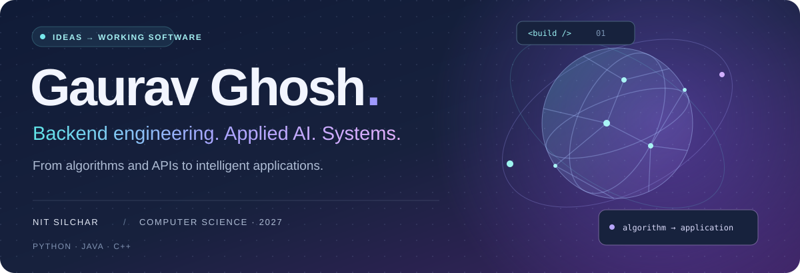
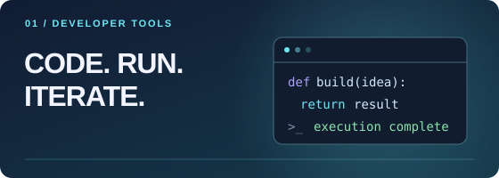

  

  
  
  
  

### A little about me

I’m **Gaurav**, a Computer Science undergraduate at **NIT Silchar (Class of 2027)**. I turn algorithmic thinking into backend services, intelligent applications, and experiments in GPU-accelerated geometry.

- **Build** — backend systems with Java, Spring Boot, Python, and FastAPI.
- **Explore** — retrieval-augmented generation, local language models, and machine learning.
- **Experiment** — CPU/GPU algorithms, computational geometry, and performance tradeoffs.

## Selected work

<table>
  <tr>
    <td width="50%" valign="top">
      
      <h3><a href="https://github.com/gauravghosh24/OnlineCompiler">Online Compiler ↗</a></h3>
      
Run C++, Java, and Python in Docker containers, with custom input and execution timeouts.

      
<b>Java · Spring Boot · Docker</b>

    </td>
    <td width="50%" valign="top">
      
      <h3><a href="https://github.com/gauravghosh24/Enterprise_level_Analyzer">Document Intelligence ↗</a></h3>
      
Ask questions across PDFs using local embeddings, vector retrieval, and source-page references.

      
<b>Python · Streamlit · Qdrant · Groq</b>

    </td>
  </tr>
  <tr>
    <td width="50%" valign="top">
      
      <h3><a href="https://github.com/gauravghosh24/FLipkartTraffic_Control_Round2">TrafficOps AI ↗</a></h3>
      
Explore congestion risk, graph-based diversions, and feedback-driven resource recommendations.

      
<b>FastAPI · scikit-learn · JavaScript</b>

    </td>
    <td width="50%" valign="top">
      
      <h3><a href="https://github.com/gauravghosh24/Voronoi_Diagram">GPU Voronoi Research ↗</a></h3>
      
Compare discrete circle-growing and Jump Flooding with a brute-force baseline for correctness, runtime, and memory use.

      
<b>Python · NumPy · Taichi</b>

    </td>
  </tr>
</table>

**Also building:** [OmniLocalize AI](https://github.com/gauravghosh24/OmniLocalize-AI) — local text translation for Hindi, Tamil, French, and German with NLLB-200, FastAPI, and Next.js.

## My toolkit

  
  
  
  
  
  
  
  
  
  
  
  
  

**Behind the tools:** REST APIs · WebSockets · MySQL · MongoDB · LangChain · Vector search · Linux

## Beyond the projects

I enjoy algorithmic problem solving and exploring how systems behave under real constraints. You can find my coding profiles on [LeetCode](https://leetcode.com/u/gaurav_ghosh_2404/) and [Codeforces](https://codeforces.com/profile/Eren_Yeger24).

  

